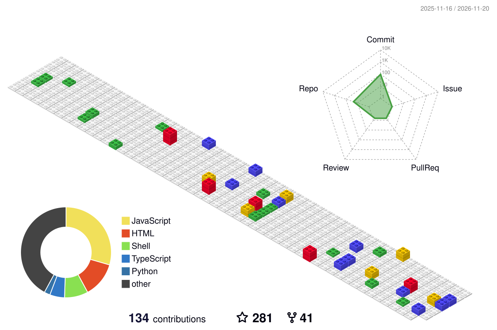

 <pre>
_______     ___    _   _ 
| ____\ \   / / \  | \ | |
|  _|  \ \ / / _ \ |  \| |
| |___  \ V / ___ \| |\  |
|_____|  \_/      \_ | \_|
  
</pre>

<i>builder  ·  tinkerer  ·  minimalist</i>

 

  

  
  
  

  

---

### 📌 featured

[Smailr 邮件助手](https://github.com/EvanTop/smailr-mail-assistant) — Smailr 的 Chromium 扩展，工具栏直达收件箱，支持多账户与邮件提醒。

  
  
  
  
  

[SmailrX](https://github.com/EvanTop/SmailrX) — Smailr 的 Android 原生应用，插件功能完整移植，支持多账户与邮件提醒。

  
  
  
  
  

[EvanPhoto](https://github.com/EvanTop/EvanPhoto) — 极简沉浸式画廊主题，零冗余设计让照片成为主角，可独立建站。

  
  
  
  
  

[EVASafe](https://github.com/EvanTop/EVASafe) — 完全离线的安卓密码管理器，PIN + 指纹解锁，加密备份，密码只存本机。

  
  
  
  
  

---

### 📦 all projects

| project | description | stack | ⭐ |
| --- | --- | --- | --- |
| [**WorkBuddy-Dashboard**](https://github.com/EvanTop/WorkBuddy-Dashboard) | WorkBuddy 本地使用数据看板 | `HTML` | 8 |
| [**EvanMarvis**](https://github.com/EvanTop/EvanMarvis) | Marvis 使用统计看板 | `Python` | 1 |
| [**Smailr 邮件助手**](https://github.com/EvanTop/smailr-mail-assistant) | Smailr 浏览器扩展 · 收件箱 / 多账户 / 提醒 | `JS` · Manifest V3 · Chrome Ext | 2 |
| [**SmailrX**](https://github.com/EvanTop/SmailrX) | Smailr 安卓应用 · 插件同源 | `Kotlin` · `Compose` · `Android` | 2 |
| [**EvanPhoto**](https://github.com/EvanTop/EvanPhoto) | 极简画廊主题 · EXIF / 上传 / 分享 | `PHP` · `WordPress` · `HTML` | 5 |
| [**EVASafe**](https://github.com/EvanTop/EVASafe) | 离线安卓密码管理器 · PIN + 指纹 · 加密备份 | `Android` · `Kotlin` · `Flutter` | 6 |
| [**TabOut**](https://github.com/EvanTop/TabOut) | Chrome 标签页管理 · 域名分组 / 导航 | `JS` · Chrome Ext V3 | 10 |
| [**EvanMi**](https://github.com/EvanTop/EvanMi) | 极简域名导航页 · 后台管理 | `HTML` | 32 |
| [**EvanNav**](https://github.com/EvanTop/EvanNav) | 个人私有化导航与收藏 | `JS` | 114 |

---

  
  

 

  

